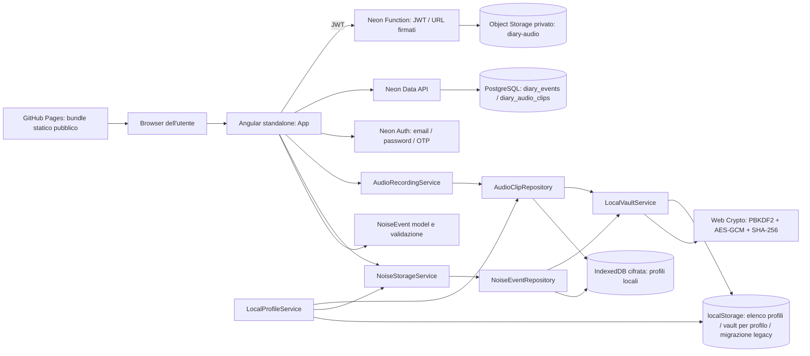

# Architettura attuale

## Vista d’insieme

La modalità locale cifra eventi e byte audio prima di scriverli in IndexedDB. La modalità account conserva gli eventi in PostgreSQL e gli audio in un bucket privato Neon Object Storage: i dati cloud non sono cifrati end-to-end dall’app. Le policy RLS vincolano le righe al `user_id` autenticato e la Function verifica il JWT prima di firmare operazioni limitate al prefisso dell’utente. Il frontend contiene solo URL pubblici; le credenziali S3 sono iniettate nell’ambiente server della Function. I due archivi restano distinti fino a un’importazione esplicita da backup.

## Componenti e responsabilità

- `src/main.ts` avvia direttamente il componente `App`.
- `src/app/app.ts` contiene UI state, form, filtri, selezione, import/export, lifecycle del vault e orchestrazione audio. Lo stato usa Angular signals locali; non è presente uno store dedicato.
- `src/app/app.html` rende l'accesso account, l'autenticazione locale, il form, l'elenco, il dettaglio e i controlli audio.
- `src/app/domain/noise-event.model.ts` dichiara modelli e validatore runtime per `NoiseEvent`. Non esiste un package/domain service separato.
- `src/app/services/noise-storage.service.ts` valida import/salvataggi e migra dati legacy da localStorage.
- `src/app/services/noise-event.repository.ts` conserva eventi cifrati in IndexedDB.
- `src/app/services/local-profile.service.ts` gestisce i nomi e gli ID dei profili locali; non autentica identità online.
- `src/app/services/local-vault.service.ts` crea/deriva la chiave e cifra/decifra con Web Crypto.
- `src/app/services/neon-auth.service.ts` incapsula login, registrazione, verifica OTP, recupero password e sessione Neon Auth.
- `src/app/services/neon-diary.service.ts` legge e scrive gli eventi cloud tramite Data API; l'identità utente non è accettata dal client come parametro.
- `src/app/services/neon-audio.repository.ts` sincronizza metadata in PostgreSQL e blob con URL firmati dalla Function.
- `functions/diary-audio/index.ts` verifica JWT con JWKS, applica CORS e limita gli oggetti al prefisso del `sub` autenticato.
- `database/migrations/001_user_diaries.sql` definisce le tabelle cloud, chiavi composte, relazione audio-evento e policy RLS.
- `src/app/audio/audio-recording.service.ts` acquisisce il microfono solo su comando esplicito, calcola l’hash iniziale e applica limiti di registrazione.
- `src/app/audio/audio-clip.repository.ts` cifra e conserva contenuto e metadati audio in IndexedDB.
- `src/app/app.routes.ts` esporta un array di route vuoto; l’app è una sola vista/component tree.

## Flusso di accesso e persistenza

1. Al caricamento, `App.initialize()` ripristina la sessione Neon Auth se presente; altrimenti mostra login/registrazione e mantiene la scelta esplicita della modalità locale.
2. Gli account usano Neon Auth email/password, verifica email OTP e recupero password OTP. Neon Auth gestisce password e sessioni; il frontend non salva la password in chiaro.
3. La Data API assegna `user_id` con `auth.user_id()` e le policy PostgreSQL controllano l'utente a ogni operazione. Le chiavi primarie composte includono `(user_id, id)` per impedire collisioni tra account.
4. I blob audio vengono caricati direttamente su Object Storage con URL firmati a breve durata; la Function verifica la firma JWT, prende `sub` come proprietario e non accetta un ID proprietario dal client.
5. In modalità locale, `LocalProfileService` conserva ID e nomi in `noise-diary.profiles.v1`; la selezione configura vault e database IndexedDB separati. La chiave dati AES-256 è avvolta con AES-GCM da chiavi PBKDF2-SHA-256 (310.000 iterazioni) derivate da password e chiave di recupero.
6. Lock, logout o cambio modalità svuota lo stato privato dall'interfaccia e chiude le risorse locali. La revisione dell'archivio invalida risposte ed errori tardivi di eventi/audio e l'export; un ID di richiesta audio distingue anche selezioni ripetute dello stesso evento. Una risposta precedente non modifica il loading della nuova sessione. Un backup locale cifrato può essere importato esplicitamente nell'account; non avviene alcuna migrazione automatica. Scritture/importazioni gia' iniziate richiedono ancora una gestione separata della concorrenza.

Il cloud separa gli account ma non fornisce cifratura end-to-end: chiavi e contenuti locali non vengono usati per cifrare i record cloud. La modalità locale, invece, separa i vault solo nel browser e non protegge da codice malevolo eseguito nello stesso profilo browser. Non c’è timeout di inattività. Il backup portabile è cifrato separatamente con AES-GCM e PBKDF2; serve la password usata durante l'esportazione. Il browser/OS può comunque influire su cache e profilo utente.

## Modello evento effettivo

`NoiseEvent` include ID, `startedAt`, timestamp di creazione/aggiornamento, luogo libero, stanza, tipo, andamento, intensità percepita, effetti, campo sorgente marcato “ipotesi”, descrizione, note, tag, status, riferimenti a clip e cronologia delle correzioni. Una correzione conserva il motivo e uno snapshot precedente; la cronologia resta parte dell'evento cifrato in IndexedDB.

Campi opzionali includono durata, fine calcolata, finestre/porta/posizione microfono, numero di testimoni e cancellazione logica. Non sono persistiti fuso orario dichiarato, orario del dispositivo come dato distinto, allegati documentali, contatti, comunicazioni, coordinate/planimetria, unità e condizioni di una misurazione o versione schema/app nell’export. Gli oggetti aggiuntivi dichiarati nel file modello non equivalgono a funzionalità integrate.

## Audio e hash

La registrazione usa `getUserMedia` e `MediaRecorder`, solo dopo click e permesso. Il limite è 300 secondi o 50 MiB; il tipo MIME è scelto tra i candidati supportati dal browser. SHA-256 è calcolato sul blob acquisito e salvato nei metadati. I download cloud sono verificati rispetto all'hash prima di essere mostrati. L'hash non attesta autore, origine, momento o autenticità.

## Import, export e UI

- Import JSON storico o `.ndbackup` con limite UI di 120 MiB, parse e validazione; i conflitti episodio richiedono una scelta esplicita. Non vengono generati nuovi export in chiaro.
- Gli eventi possono essere modificati con motivo obbligatorio e snapshot precedente, oppure eliminati dopo conferma. La cancellazione di un evento e dei suoi audio associati usa una singola transazione IndexedDB; non garantisce l'eliminazione da backup o sincronizzazioni del profilo.
- Il backup `.ndbackup` contiene eventi e registrazioni audio cifrati. L'export locale verifica la password del vault; l'export account usa una passphrase autonoma confermata, senza leggere/configurare il vault. La stessa passphrase/password usata all'esportazione e' richiesta all'importazione. Envelope e payload mantengono la versione 1. L'importazione aggiuntiva conserva i dati locali, risolve i conflitti di ID esplicitamente e salva eventi e nuovi audio in una transazione IndexedDB. Il ripristino sostitutivo richiede conferma ed elimina i contenuti audio non inclusi nel backup. Il percorso cloud DB/S3 non e' una transazione unica.
- I file JSON storici in chiaro restano importabili solo dopo un avviso e non contengono audio. Non vengono più creati nuovi export in chiaro.
- La UI filtra per testo e ordina per data/intensità/stanza. Non ci sono filtri temporali, calendario, selezione di un sottoinsieme per export o oscuramento.
- Il pannello di analisi frequenze è un placeholder sempre vuoto. La media mostrata è una media aritmetica delle intensità soggettive degli eventi caricati.
- Il servizio worker è attivo nella build production e memorizza bundle/assets statici; non è un archivio di backup dei dati IndexedDB.

## Hosting, CI e configurazione

Il frontend è statico su GitHub Pages; Auth, Data API, PostgreSQL, Function e Object Storage risiedono nel progetto Neon `noise-diary` in `aws-eu-central-1`. Il workflow PR esegue npm ci, controllo contenuti, Prettier su Markdown/YAML/tools, test e build. Il workflow di deploy esegue test/build e pubblica il bundle al push su `main`. Un deploy del backend Neon non pubblica automaticamente il frontend: la build frontend deve essere pubblicata separatamente. La configurazione email usa attualmente il provider condiviso Neon; per uso pubblico è necessario configurare un provider SMTP dedicato. I permessi e i tag delle Actions sono definiti nei workflow; branch protection e rulesets sono menzionati in `GOVERNANCE.md` ma non verificabili dal repository.
