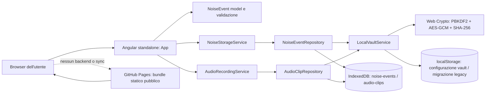

# Architettura attuale

## Vista d’insieme

I dati degli eventi e i byte audio sono cifrati dall’app prima della scrittura in IndexedDB. I record IndexedDB espongono gli ID e, per l’audio, l’ID evento; i contenuti restano nel payload cifrato. La configurazione locale del vault contiene salt, IV e verifier cifrato, non la password o la chiave.

## Componenti e responsabilità

- `src/main.ts` avvia direttamente il componente `App`.
- `src/app/app.ts` contiene UI state, form, filtri, selezione, import/export, lifecycle del vault e orchestrazione audio. Lo stato usa Angular signals locali; non è presente uno store dedicato.
- `src/app/app.html` rende il form, elenco, dettaglio, autenticazione locale, controlli audio, placeholder analisi e disclaimer.
- `src/app/domain/noise-event.model.ts` dichiara modelli e validatore runtime per `NoiseEvent`. Non esiste un package/domain service separato.
- `src/app/services/noise-storage.service.ts` valida import/salvataggi e migra dati legacy da localStorage.
- `src/app/services/noise-event.repository.ts` conserva eventi cifrati in IndexedDB.
- `src/app/services/local-vault.service.ts` crea/deriva la chiave e cifra/decifra con Web Crypto.
- `src/app/audio/audio-recording.service.ts` acquisisce il microfono solo su comando esplicito, calcola l’hash iniziale e applica limiti di registrazione.
- `src/app/audio/audio-clip.repository.ts` cifra e conserva contenuto e metadati audio in IndexedDB.
- `src/app/app.routes.ts` esporta un array di route vuoto; l’app è una sola vista/component tree.

## Flusso di accesso e persistenza

1. Al caricamento, `App.initialize()` controlla la configurazione vault in localStorage e mostra setup, lock o errore.
2. L’utente crea una password di almeno 12 caratteri o la inserisce per sbloccare.
3. La chiave AES-256 viene derivata da PBKDF2-SHA-256 con sale casuale e 310.000 iterazioni. La password non viene conservata dal servizio; la chiave resta in memoria fino a lock o distruzione del componente.
4. Eventi e audio sono letti/validati da IndexedDB. La migrazione legacy avviene dopo lo sblocco.
5. Il lock manuale svuota gli stati decifrati dell’interfaccia, revoca URL audio e rilascia il riferimento alla chiave.

Non c’è timeout di inattività, recupero password, sincronizzazione, backup o backend. Il browser/OS può comunque influire su storage, cache e profilo utente.

## Modello evento effettivo

`NoiseEvent` include ID, `startedAt`, timestamp di creazione/aggiornamento, luogo libero, stanza, tipo, andamento, intensità percepita, effetti, campo sorgente marcato “ipotesi”, descrizione, note, tag, status, riferimenti a clip e cronologia delle correzioni. Una correzione conserva il motivo e uno snapshot precedente; la cronologia resta parte dell'evento cifrato in IndexedDB.

Campi opzionali includono durata, fine calcolata, finestre/porta/posizione microfono, numero di testimoni e cancellazione logica. Non sono persistiti fuso orario dichiarato, orario del dispositivo come dato distinto, allegati documentali, contatti, comunicazioni, coordinate/planimetria, unità e condizioni di una misurazione o versione schema/app nell’export. Gli oggetti aggiuntivi dichiarati nel file modello non equivalgono a funzionalità integrate.

## Audio e hash

La registrazione usa `getUserMedia` e `MediaRecorder`, solo dopo click e permesso. Il limite è 300 secondi o 50 MiB; il tipo MIME è scelto tra i candidati supportati dal browser. SHA-256 è calcolato sul blob acquisito e salvato nei metadati cifrati. Al caricamento viene decifrato il blob ma l’hash non è ricomputato per confronto. L’hash non attesta autore, origine, momento o autenticità.

## Import, export e UI

- Import JSON locale, file fino a 5 MiB, estensione `.json`, parse e validazione; duplicati per ID vengono ignorati. L’export generato è JSON in chiaro, contiene eventi e timestamp di export, non audio, filtri o manifest.
- Gli eventi possono essere modificati con motivo obbligatorio e snapshot precedente, oppure eliminati dopo conferma. La cancellazione di un evento e dei suoi audio associati usa una singola transazione IndexedDB; non garantisce l'eliminazione da backup o sincronizzazioni del profilo.
- La UI filtra per testo e ordina per data/intensità/stanza. Non ci sono filtri temporali, calendario, selezione di un sottoinsieme per export o oscuramento.
- Il pannello di analisi frequenze è un placeholder sempre vuoto. La media mostrata è una media aritmetica delle intensità soggettive degli eventi caricati.
- Il servizio worker è attivo nella build production e memorizza bundle/assets statici; non è un archivio di backup dei dati IndexedDB.

## Hosting, CI e configurazione

Il sito è statico su GitHub Pages. Il workflow PR esegue npm ci, controllo contenuti, Prettier su Markdown/YAML/tools, test e build. Il workflow di deploy esegue test/build e pubblica il bundle al push su `main`. I permessi e i tag delle Actions sono definiti nei workflow; branch protection e rulesets sono menzionati in `GOVERNANCE.md` ma non verificabili dal repository. Non c’è configurazione CSP o E2E nel repository.
